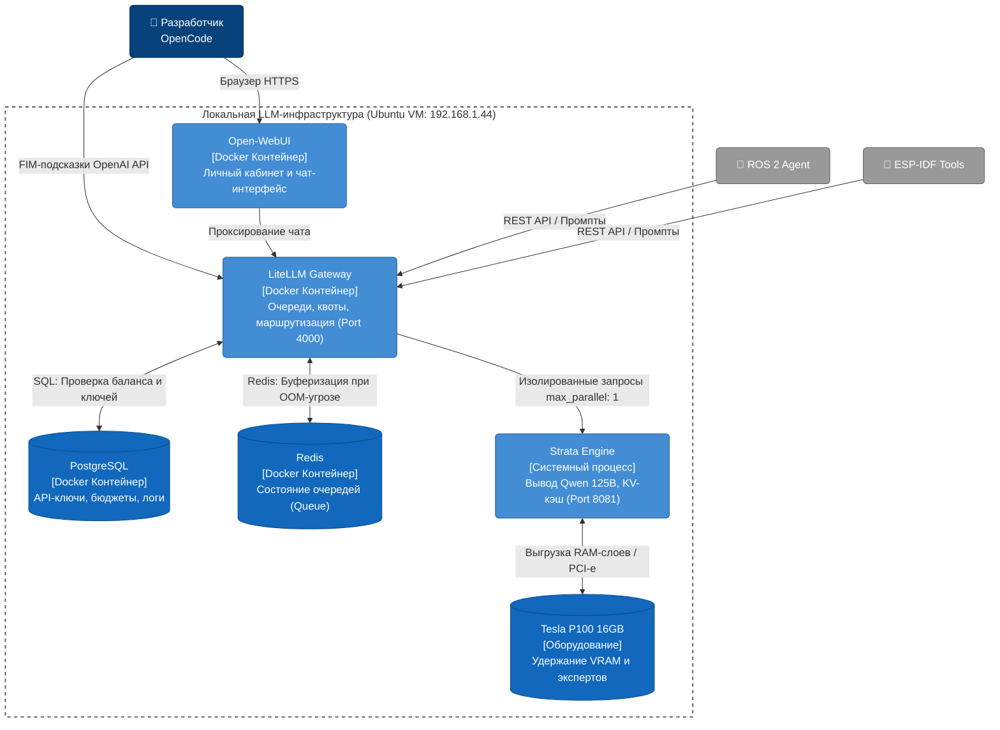

# 🧠 Local LLM Infrastructure (Strata + LiteLLM)


Этот репозиторий содержит конфигурацию высоконагруженной локальной инфраструктуры для запуска больших языковых моделей (LLM). Инфраструктура специально спроектирована для работы с **Qwen3.8-Flash-Next (125B параметров, MoE, IQ3_S)** в условиях экстремальной нехватки VRAM (одна Tesla P100 16GB) с активным вытеснением весов в системную память (RAM Offload).

Проект обеспечивает стабильное API для:
1. Автономных агентов **ROS 2** (робособака) с длинными контекстами логов.
2. IDE-плагинов **OpenCode** (FIM-автодополнение кода).
3. Скриптов компиляции **ESP-IDF**.

## 🚀 Ключевые особенности и оптимизации

*   **Extreme RAM Offload:** Удержание 125B модели на 16GB VRAM (4,835 экспертов) и 65GB системной RAM. Скорость вывода: **~28-30 tok/s**.
*   **Защита от OOM (Out of Memory):** 
    * Жесткое квотирование через `LiteLLM` (`max_parallel_requests: 1`).
    * Буферизация конкурентных запросов через очередь `Redis` (предотвращает HTTP Timeout в IDE).
    * Резервирование памяти ОС (`--conversation-cache-min-free-mib 6144`).
*   **Спекулятивное декодирование:** Использование черновой модели (Draft Model Qwen 1.5B, `IQ1_M`), жестко привязанной к 4 потокам CPU (`--aux-cpus 4`), для валидации батчей на GPU.
*   **64K Context Window + Context Shift:** Продвинутое управление KV-кэшем (`--kv-resident 16384`) со скользящим окном, исключающее переполнение при отправке тяжелых графов ROS 2.

## 🏗 Архитектура (Deployment)



*(Дополнительные архитектурные артефакты, включая C4 Diagram, Sequence Diagram и ADR, находятся в директории `docs/architecture/`)*.

## 🛠 Системные требования

*   **ОС:** Ubuntu 22.04 LTS / 24.04 LTS (Native или Proxmox VM).
*   **RAM:** Минимум 65 ГБ.
*   **GPU:** NVIDIA Tesla P100 16GB (или аналог с 16GB VRAM, драйвер CUDA 12+).
*   **Диск:** SSD/NVMe с минимум 50 ГБ свободного места (10 ГБ под Docker тома + модели).
*   **ПО:** Docker, Docker Compose, Strata Engine.

## 📦 Быстрый старт

### Шаг 1: Запуск Strata Engine (Native)
Из-за специфики работы с PCI-e, RAM Offload и CPU-привязками для Draft-модели, Strata запускается вне Docker-контура.
Убедитесь, что параметры запуска соответствуют нашему профилю тюнинга:
*   Порт: `8081`
*   Limit Context: `65536`
*   KV-resident: `16384`
*   Context Shift: `on`
*   STRATA_DEFAULTS: `off`
*   Draft: `path/to/qwen1.5b.gguf -ngl 0`

### Шаг 2: Запуск шлюза и мониторинга (Docker)
Вся инфраструктура очередей, UI и сбора метрик поднимается одной командой:
```bash
# Клонирование репозитория
git clone https://github.com/your-username/llm-infra.git
cd llm-infra

# Запуск стека в фоновом режиме
sudo docker-compose up -d
```

### Шаг 3: Проверка работоспособности
1.  **LiteLLM Gateway:** `http://<YOUR_IP>:4000`
2.  **Open-WebUI:** `http://<YOUR_IP>:3000`
3.  **Grafana Dashboards:** `http://<YOUR_IP>:3001` (Логин/Пароль: admin / admin_ros2)

Для проверки проксирования отправьте тестовый запрос:
```bash
curl --location 'http://localhost:4000/v1/chat/completions' \
--header 'Authorization: Bearer sk-master-key-ros2' \
--header 'Content-Type: application/json' \
--data '{
    "model": "qwen3.8-flash-next-iq3_s",
    "messages": [{"role": "user", "content": "Ping"}]
}'
```

## 📊 Мониторинг
Метрики собираются автоматически через `Prometheus`. Дашборды `Grafana` преднастроены через Provisioning. Вы можете отслеживать:
* Потребление RAM/VRAM и утилизацию PCIe.
* Количество токенов в секунду (Tok/s) и задержку до первого токена (TTFT).
* Балансы виртуальных кошельков агентов (ROS 2 / OpenCode).

## 📄 Лицензия
Этот проект распространяется под лицензией MIT. Подробности см. в файле `LICENSE`.